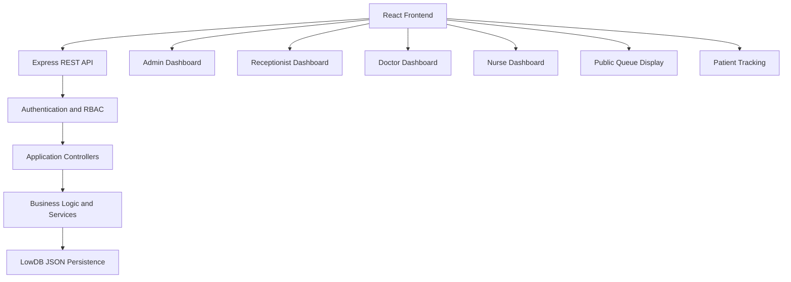

# MediQueue – Hospital Queue Management System

A full-stack Hospital Queue Management System designed to simplify outpatient operations, manage patient appointments, organize priority-based queues, and improve coordination between hospital staff and patients.

[](https://nodejs.org/)
[](https://react.dev/)
[](https://expressjs.com/)
[](LICENSE)

---

## Table of Contents

- [Project Overview](#project-overview)
- [Problem Statement](#problem-statement)
- [Key Features](#key-features)
- [User Roles](#user-roles)
- [Priority Queue Management](#priority-queue-management)
- [System Architecture](#system-architecture)
- [Technology Stack](#technology-stack)
- [Project Structure](#project-structure)
- [Getting Started](#getting-started)
- [Environment Configuration](#environment-configuration)
- [Demo Accounts](#demo-accounts)
- [Testing and Quality Assurance](#testing-and-quality-assurance)
- [Screenshots](#screenshots)
- [API Documentation](#api-documentation)
- [Security](#security)
- [Future Enhancements](#future-enhancements)
- [License](#license)

---

## Project Overview

MediQueue is a web-based Hospital Queue Management System that manages the outpatient patient journey, from patient registration and appointment booking to queue allocation, doctor consultation, and prescription management.

The system provides separate dashboards for administrators, receptionists, doctors, and nurses.

It also provides public queue displays and patient tracking functionality, helping patients stay informed about their queue status.

## Problem Statement

Traditional hospital queue management can lead to:

- Long and unpredictable waiting times.
- Poor visibility into patient queue status.
- Difficulty managing emergency and priority patients.
- Appointment scheduling conflicts.
- Manual administrative work.
- Communication gaps between hospital departments.

**MediQueue addresses these challenges through:**

1. Priority-based patient queue management.
2. Patient registration and appointment scheduling.
3. Role-based dashboards for hospital staff.
4. Doctor consultation and prescription workflows.
5. Public queue displays and patient tracking.
6. Administrative reports and audit logging.

---

## Key Features

### Patient Management
- Register new patients.
- Update patient information.
- View patient profiles and visit history.
- Access previous consultations and prescriptions.

### Appointment Management
- Book patient appointments.
- Reschedule and cancel appointments.
- Prevent conflicting appointment bookings.
- Manage appointment check-in.

### Queue Management
- Generate patient tokens.
- Support emergency and priority patients.
- Call the next eligible patient.
- Skip patients who do not respond.
- Recall skipped patients.
- Track queue status.

### Doctor Consultation
- View assigned patient queues.
- Record patient complaints and clinical findings.
- Add diagnoses and follow-up dates.
- Create prescriptions containing multiple medicines.
- Access patient consultation history.

### Public Queue Tracking
- Display currently serving tokens.
- Show room information and upcoming tokens.
- Allow patients to track queue status using a QR code or tracking ID.
- Avoid displaying patient names on the public queue screen.

### Reports and Administration
- Manage hospital departments and examination rooms.
- Manage doctors and staff accounts.
- View operational reports and analytics.
- Export supported reports to CSV.
- Maintain audit logs of important system activities.
- Configure hospital settings.

---

## User Roles

| Role | Main Responsibilities |
|---|---|
| Administrator | Manage departments, rooms, doctors, staff, reports, and system settings |
| Receptionist | Register patients, schedule appointments, issue tokens, and manage queues |
| Doctor | Manage consultations, diagnoses, prescriptions, and patient history |
| Nurse | Monitor queues, assist with patient intake, and support triage operations |
| Public Patient | View public queue information and track a personal token |

### 1. Administrator

- Hospital operational dashboard.
- Department and room management.
- Doctor and staff management.
- Reports and analytics.
- Audit log access.
- System configuration.

### 2. Receptionist

- Patient registration.
- Appointment booking and check-in.
- Walk-in patient registration.
- Token generation.
- Queue management.
- Emergency patient alerts.

### 3. Doctor

- View assigned patient queue.
- Call and manage consultations according to permissions.
- Record clinical notes and diagnosis.
- Create multi-item prescriptions.
- View patient visit history.

### 4. Nurse

- Monitor patient queues.
- View waiting and active patients.
- Assist with patient intake and triage.
- Work within assigned role permissions.

### 5. Public Patient

- View the hospital's public queue display.
- Track a token using its tracking ID or QR code.
- Check queue position and estimated waiting information.

---

## Priority Queue Management

MediQueue uses priority-based scheduling rather than relying only on standard First-In-First-Out (FIFO) ordering.

| Priority Category | Weight | Queue Priority |
|---|---:|---|
| Emergency | 0 | Highest |
| Senior Citizen | 1 | High |
| Pregnant Patient | 1 | High |
| Special Needs | 1 | High |
| Normal | 2 | Standard |

The queue engine uses priority weight and arrival time to determine the next eligible patient.

**Scheduling order:**

1. Emergency patients.
2. Other priority patients.
3. Normal patients.

Patients within the same priority level are ordered by arrival time.

Emergency cases should always be handled according to clinical judgment and hospital procedures.

---

## System Architecture

MediQueue follows a frontend-backend architecture.



### Architecture Components

- **Frontend:** React application for user interfaces and dashboards.
- **Backend:** Express REST API for business logic and application operations.
- **Authentication:** JWT-based authentication.
- **Authorization:** Role-based access control.
- **Persistence:** LowDB with local JSON-file storage.
- **Testing:** Automated backend tests and browser QA tools.

MongoDB integration may be considered as a future database enhancement.

---

## Technology Stack

| Layer | Technologies |
|---|---|
| Frontend | React 19, Vite, React Router, Tailwind CSS |
| Backend | Node.js, Express 5 |
| Authentication | JSON Web Tokens (JWT), bcryptjs |
| Database | LowDB, JSON-file persistence |
| API | REST API, Axios |
| Validation | Express Validator, Zod |
| Visualization | Recharts |
| Testing | Node.js Test Runner, Puppeteer-Core |
| Code Quality | Oxlint |
| CI/CD | GitHub Actions |

---

## Project Structure

```text
hospital-queue-management/
│
├── .github/
│   └── workflows/
│       └── ci.yml
│
├── client/
│   ├── src/
│   │   ├── components/
│   │   ├── constants/
│   │   ├── context/
│   │   ├── layouts/
│   │   ├── pages/
│   │   ├── routes/
│   │   └── services/
│   └── vite.config.js
│
├── docs/
│   ├── screenshots/
│   ├── API.md
│   ├── ARCHITECTURE.md
│   ├── DATABASE.md
│   ├── DEMO_ACCOUNTS.md
│   ├── QUEUE_LOGIC.md
│   └── TESTING.md
│
├── qa/
│   └── run-browser-tests.js
│
├── server/
│   ├── config/
│   ├── controllers/
│   ├── middleware/
│   ├── models/
│   ├── routes/
│   ├── seed/
│   ├── services/
│   └── tests/
│
├── .gitignore
├── package.json
├── package-lock.json
└── README.md
```

---

## Getting Started

### Prerequisites

Install the following before running the project:

- Node.js 20 or later.
- npm.
- Google Chrome (required for the browser QA suite).

### 1. Clone the Repository

```bash
git clone https://github.com/sneh8989/MediQueue-Hospital-Queue-Management.git
```

### 2. Open the Project Folder

```bash
cd MediQueue-Hospital-Queue-Management
```

### 3. Install Dependencies

```bash
npm run install:all
```

### 4. Configure Environment Variables

Create local environment files using the provided examples.

See the [Environment Configuration](#environment-configuration) section.

### 5. Initialize Demo Data

```bash
npm run seed
```

Run this command if the project provides the seed script and you want to initialize demo accounts and data.

### 6. Start the Backend

Open a terminal:

```bash
npm run dev:server
```

Backend URL:

`http://localhost:5000`

Health check:

`http://localhost:5000/api/health`

### 7. Start the Frontend

Open another terminal:

```bash
npm run dev:client
```

Frontend URL:

`http://localhost:5173`

---

## Environment Configuration

Create local environment files from the example files.

### Backend

```bash
cp server/.env.example server/.env
```

### Frontend

```bash
cp client/.env.example client/.env
```

Configure the required environment variables according to the example files.

**Important:** Never upload actual `.env` files, passwords, JWT secrets, or other private credentials to GitHub.

---

## Demo Accounts

The project documentation describes the following development demo accounts.

| Role | Email | Password |
|---|---|---|
| Administrator | `admin@mediqueue.test` | `Admin@123` |
| Receptionist | `reception@mediqueue.test` | `Reception@123` |
| Doctor | `doctor@mediqueue.test` | `Doctor@123` |
| Nurse | `nurse@mediqueue.test` | `Nurse@123` |

**Note:** These are development/demo credentials, not real hospital accounts. Use them only in a local development environment. Change or remove demo credentials before any public deployment.

For more information, see [Demo Accounts Documentation](docs/DEMO_ACCOUNTS.md).

---

## Testing and Quality Assurance

The project includes automated backend tests, frontend quality checks, and browser automation.

### Backend Tests

```bash
npm run test:server
```

The existing project documentation reports 186 passing backend tests. Run the command locally to verify the current result.

### Frontend Linting

```bash
npm run lint:client
```

### Frontend Production Build

```bash
npm run build:client
```

### Browser QA

```bash
npm run test:qa
```

The browser QA suite uses Puppeteer-Core and Google Chrome to test supported application workflows.

For test details and verification information, see [Testing Documentation](docs/TESTING.md).

---

## Screenshots

The following screenshots are referenced from the project's documentation folder.

| Screen | Description |
|---|---|
| Login | Role-based login page |
| Admin Dashboard | Hospital operational overview |
| Patient Profile | Patient information and visit history |
| Department Management | Department administration |
| Room Management | Examination room administration |
| Doctor Management | Doctor information and assignments |
| Staff Management | Staff account management |
| Reports | Hospital reports and analytics |
| Audit Logs | Administrative activity records |
| System Settings | Hospital configuration |
| Reception Dashboard | Patient arrival and reception overview |
| Appointments | Appointment management |
| Check-in | Appointment check-in and token generation |
| Walk-in Registration | Walk-in patient token generation |
| Queue Board | Patient queue management |
| Doctor Dashboard | Doctor's patient queue |
| Consultation | Clinical notes and prescriptions |
| Nurse Dashboard | Queue monitoring |
| Public Display | Public waiting-room queue |
| Patient Tracking | Mobile queue tracking |
| Priority Queue | Priority scheduling demonstration |
| Mobile Navigation | Responsive navigation |
| Mobile Reception | Reception dashboard on mobile |

See the [`docs/screenshots/`](docs/screenshots/) folder for available screenshots.

---

## API Documentation

The backend exposes REST API endpoints under the `/api` path.

| Resource | Example Endpoints |
|---|---|
| Health | `GET /api/health` |
| Authentication | `/api/auth/login`, `/api/auth/me`, `/api/auth/logout` |
| Patients | `/api/patients` |
| Appointments | `/api/appointments` |
| Queue | `/api/queue` |
| Public Queue | `/api/public/queue` |
| Consultations | `/api/consultations` |
| Prescriptions | `/api/prescriptions` |
| Departments | `/api/departments` |
| Rooms | `/api/rooms` |
| Doctors | `/api/doctors` |
| Reports | `/api/reports` |
| Audit Logs | `/api/audit-logs` |
| Settings | `/api/settings` |

Access to protected endpoints depends on authentication and user permissions.

For detailed endpoint information, request formats, and response examples, see [API Documentation](docs/API.md).

---

## Security

The application includes security-related mechanisms such as:

- JWT-based user authentication.
- Password hashing with bcryptjs.
- Role-based access control.
- Protected API routes.
- Input validation.
- Security headers through Helmet.
- CORS configuration.
- Audit logging for supported operations.
- Restricted access to administrative functionality.
- Public queue responses designed to avoid exposing patient names.

**Deployment note:** This project should undergo additional security, privacy, and compliance reviews before being used with real patient information or in a live hospital environment.

---

## Future Enhancements

Potential future improvements include:

- WebSocket or Server-Sent Events for real-time queue updates.
- SMS and WhatsApp notifications.
- MongoDB integration.
- HL7/FHIR-based healthcare system integration.
- Billing and invoicing.
- Native mobile applications.
- Advanced analytics and waiting-time forecasting.

---

## License

This project is licensed under the MIT License.

See the [LICENSE](LICENSE) file for details.

---

## Author

**Developed as a Hospital Queue Management System project.**

GitHub: [@sneh8989](https://github.com/sneh8989)

Project Repository: [MediQueue – Hospital Queue Management System](https://github.com/sneh8989/MediQueue-Hospital-Queue-Management)
